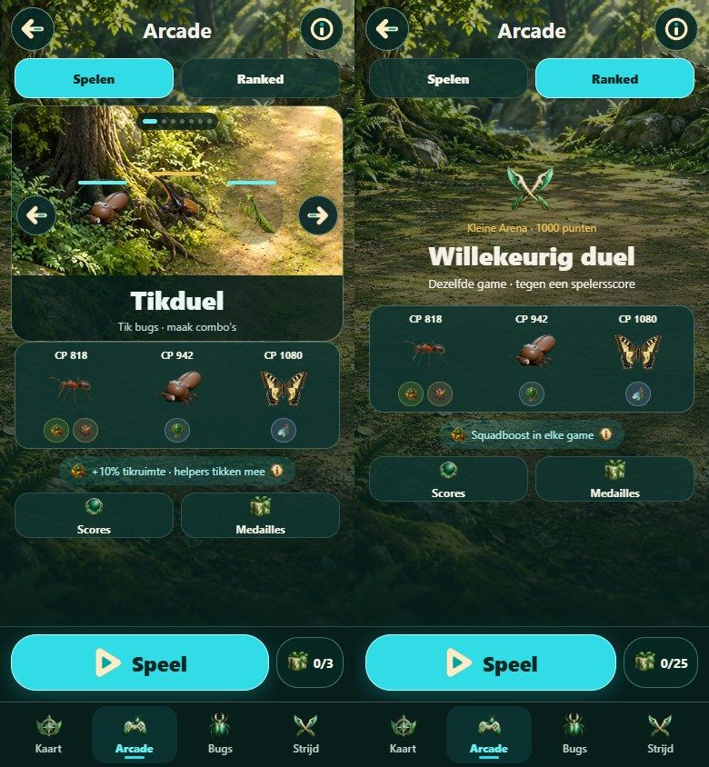
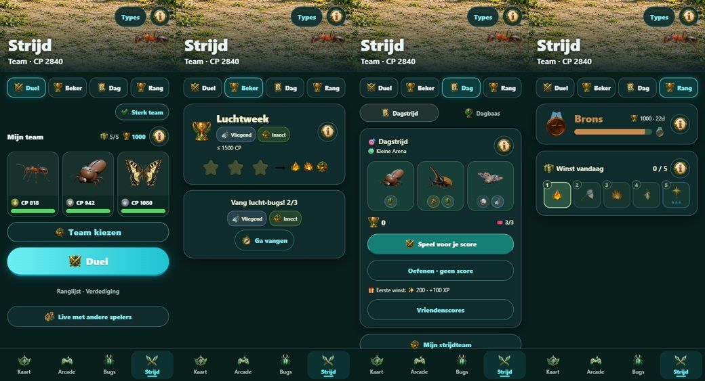
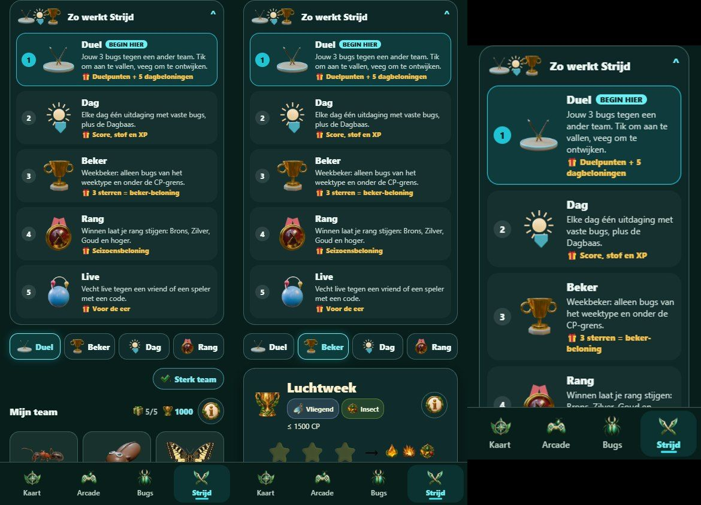
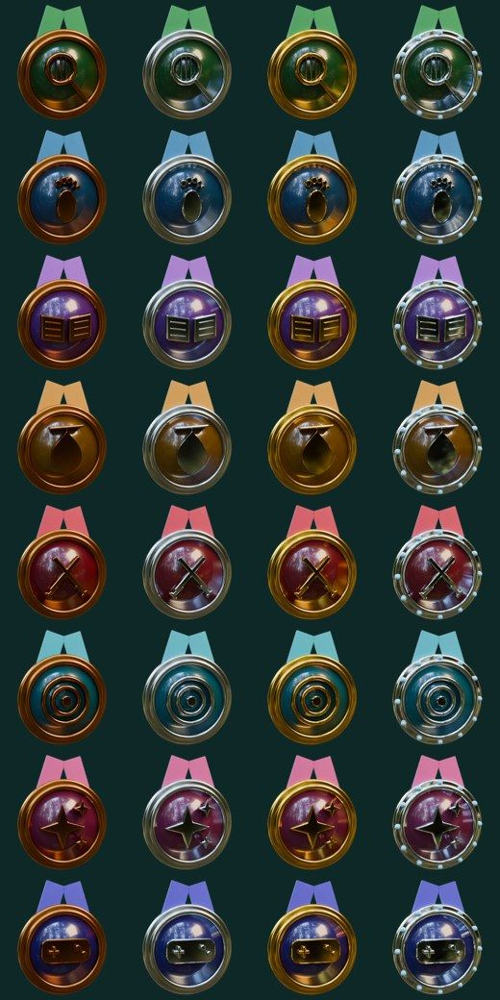

# Arcade en Strijd begrijpelijk maken — voorstel (9 november 2026)

**Vraag gebruiker:** Strijd en Arcade worden chaotisch; hoe begrijpen nieuwe spelers dit? Dingen opschorten en duidelijk maken, geen features weghalen. Meer plaatjes, correcte uitleg met plaatjes, animaties.
**Status:**
- Strijd-uitleg en plaatjes zijn gebouwd op branch `claude/cocoon-hatch`.
- Arcade is alleen een voorstel, omdat Codex nu in `ArcadeScreenV3`, `MainTabsV3`, `ArcadeSeasonV3` en `arcade/ranked` werkt (branch `codex/live-distance-update-alert`).

## 1. Wat een nieuwe speler nu ziet (release 0.1.37, browser 390×844)

 

| Probleem (bevestigd in beeld) | Waarom lastig |
|---|---|
| Strijd heeft 8 ingangen tegelijk: Duel, Beker, Dag (met Dagstrijd/Dagbaas), Rang, Types, Sterk team, Ranglijst · Verdediging en Live. | Alles is even belangrijk; er is geen startpunt. |
| Twee ranglijsten met dezelfde startwaarde "1000": Strijd-duelpunten en Arcade-Ranked ("Kleine Arena · 1000 punten"). | De speler denkt dat het één score is. |
| De tellers "0/3", "0/25", "5/5" en "0/5" hebben geen label. | Je ziet niet wat je kunt verdienen. |
| Arcade: per spel één regel ("Tik bugs · maak combo's"). Hoe je speelt, wat goed is en wat het oplevert staat er niet. | Je leert pas tijdens het spelen; een eerste fout voelt als falen. |
| "Ranked" en "Willekeurig duel · tegen een spelersscore" zijn technische woorden. | Het verschil met "Spelen" is onduidelijk. |
| Squadbonus: kleine typecirkels plus "+10% tikruimte". | Waarom je team in de Arcade uitmaakt, zie je niet. |

## 2. Principes (bronnen)

- **Stap voor stap tonen en vrijspelen.** Laat niet alle functies tegelijk zien ("feature firehose"); toon ze op het moment dat de speler eraan toe is. Bronnen: [UX Planet – progressive disclosure](https://uxplanet.org/design-patterns-progressive-disclosure-for-mobile-apps-f41001a293ba), [Apple HIG – onboarding](https://developer.apple.com/design/human-interface-guidelines/onboarding.md) ("laat spelers een mechaniek veilig proberen"), [Marvel Snap progressive onboarding](https://medium.com/alliancedao/removing-web3s-friction-pt-1-progressive-onboarding-and-games-ddf2b59ffa59).
- **Duidelijk, consistent en met feedback.** Uit het UX-raamwerk van Fortnite (Celia Hodent): één naam per begrip, en elke actie zichtbaar terugkoppelen. Bronnen: [Gamer's Brain / UX-pijlers](https://www.designative.info/2019/03/28/the-ux-of-fortnite-celia-hodent/), [GDC: UX of onboarding](https://gamedeveloper.com/design/video-inside-the-ux-of-onboarding-and-player-engagement).
- **Spelvormen als kaarten met eigen beeld.** Brawl Stars toont elke spelvorm als een kaart met eigen artwork. Een ontwerpkritiek noemt die vindbaarheid goed, maar de hoeveelheid modi "featuritis", en stelt voor ze te groeperen in drie tabbladen. Bron: [Pratt IxD-kritiek Brawl Stars](https://ixd.prattsi.org/2025/02/design-critique-brawl-stars/).
- **Referentieproces:** [Claude-Code-Game-Studios](https://github.com/Donchitos/Claude-Code-Game-Studios), skill `ux-review`. Een scherm vertrekt vanuit het doel van de speler bij aankomst, heeft lege-, laad- en foutstanden, en de UI bezit geen spelstate.

Toegepast op BugBaas:
1. Eén primaire knop per scherm.
2. Elke spelvorm krijgt een plaatje, wat het is in één zin, en wat het oplevert.
3. Een "Begin hier"-volgorde.
4. Uitleg klapt in zodra de speler het kent.
5. Niets wordt verwijderd: alles blijft bereikbaar.

## 3. Strijd — gebouwd (claude/cocoon-hatch)

- `src/StrijdGuideV3.tsx`: kaart "Zo werkt Strijd".
  - Vijf genummerde rijen, elk met een 3D-illustratie, één zin uitleg en een 🎁-regel.
  - Duel staat bovenaan als "BEGIN HIER".
  - Staat open bij minder dan 5 gevechten; daarna één regel die je weer kunt openen. Na het aantikken van een rij klapt de kaart dicht en opent de spelvorm.
- De tabs Duel, Beker, Dag en Rang hebben nu dezelfde illustraties in plaats van algemene iconen.
- Illustraties staan in `assets/v2/modes/` (Blender, eigen geometrie, `build_modes.py`, `source.json`) en zijn bruikbaar in Arcade:

Nog open in Strijd (vervolg):
- Bij Duel de tekst "5/5" vervangen door "🎁 5 dagbeloningen over".
- "Ranglijst · Verdediging" en "Live" groeperen onder een uitklapbaar "Meer manieren om te vechten".

## 4. Arcade — voorstel (voor Codex, bestanden van Codex)

**A. Speelhal-kaarten in plaats van één carrousel-regel.** Per spel een kaart met:
- groot speelbeeld;
- drie pictogrammen voor de bediening (👆 tik · ↔ veeg · ✋ houd);
- moeilijkheid (1–3 ★);
- je beste score;
- medaillevoortgang (brons/zilver/goud, 3/10/30 rondes).

Tik op een kaart en er opent een **"Zo speel je"-blad**: drie stappen met een plaatje of korte lus (bijvoorbeeld Tikduel: 1. tik bugs, 2. reeks = combo ×2, 3. squadhelpers tikken mee), met daaronder "Oefenen (geen beloning)" en "Speel (dagbeloning 1/3)".

**B. Eén naam per ladder.**

| Ladder | Nieuwe naam | Eenheid | Startwaarde |
|---|---|---|---|
| Strijd | "Strijdrang" | duelpunten | 1000, zoals nu |
| Arcade-Ranked | "Arcade-liga" | ligapunten | met een eigen beeld (`mode-wedstrijd`) |

Zo zijn de twee "1000"'s nooit meer naast elkaar verwarrend.

**C. Tellers met tekst.**
- "0/3" → "🎁 Dagbeloning 0/3"
- "0/25" → "🏆 Ligabeloningen 0/25"

**D. Ranked zacht vrijspelen.** De tab "Wedstrijd" blijft zichtbaar, maar toont tot je 3 rondes hebt gespeeld eerst een uitleg-kaart: "Je speelt hetzelfde spel als een andere speler; wie de hoogste score heeft wint ligapunten." Daaronder staat de knop "Toch spelen". Er wordt niets geblokkeerd.

**E. Squad zichtbaar maken.** "Jouw team helpt" met de drie bugs en per bug één zin wat hij in dít spel doet ("Insect: +10% tikruimte"), en een korte animatie van een helper die meetikt.

**F. Eerste keer.** Een eenmalige rondleiding van drie stappen bij het eerste bezoek. Coach-marks één voor één, op het moment dat je ze nodig hebt, en nooit een muur van tekst.

## 5. Spelregels, balans en economie

Gedaan op deze branch (bestanden buiten het lopende werk van Codex):
- **Muntbronnen:**
  - dagonderzoek +5 per taak;
  - elke 7e stempel +50;
  - weekwandeling 20/40/60;
  - gymopbrengst ongewijzigd;
  - de winkel toont "Zo verdien je coins".
- **Cocons:** 7 km 1000/15 → 2500/25 (7 km leverde per km minder op dan 5 km); cocon-XP 500/1000/1500/2000 naar afstand.
- **Levelbeloning:** 100 stof per level in plaats van 50.
- **Medaillekast** (alleen weergave, geen beloningen):

**Voor Codex** (zit in `pvpV2`, `ranksV3`, `arcade/**`, `walkCatchV2` en `goServiceV2`, waar Codex nu aan werkt):

| # | Bevinding (bevestigd in code) | Voorstel |
|---|---|---|
| 1 | Ranked GO: 500 stof + 250 XP per winst, 100 per verlies, 25 per dag, opgeven telt mee (`goServiceV2.ts:151,418`). Twee accounts kunnen ±7.300 stof per dag halen. | Alleen de eerste 5 per dag belonen, met 300/50. Geen beloning bij opgeven of bij een gevecht korter dan 30 s. Wachttijd van 15 min per paar spelers. |
| 2 | Punten tegen de computer: `max(3,16-(P-1000)/40)` (`pvpV2.ts:32`); verliezen kost niets. Alleen tegen de computer haal je Kampioen in ±19 dagen. | `max(1,12-(P-1000)/35)`. |
| 3 | Dagelijkse 5 NPC-winsten geven elke dag een ★3-bug op level 15 (`pvpV2.ts:42-44`). | Het bugvakje alleen na ≥1 winst tegen een echte speler of echo; anders 1000 stof. |
| 4 | Loopvangst: workouttempo tot 25 km/h (`walkCatchV2.ts:14`). Fietsen geeft dubbele vangsten, tot 120 per dag. | Dubbel alleen tussen 1,75 en 3,5 m/s; daggrens 60. |
| 5 | Arcade-XP 20 per ronde, maximaal 60 per dag (`arcadeServiceV3.ts:83`): minder dan 1% van de dag-XP. | 100 per ronde, maximaal 300. |
| 6 | Routes: XP = 500 + 1000/km, minimum 500 m (`routesV2.ts:39`). Korte routes zijn het voordeligst. | 200 + 1000/km. |

Bron van deze cijfers: een gelezen review van de balans (geen simulatie van echte winkansen). Telling per dag op basis van een model: 15 vangsten, 2 km lopen, 3 dagtaken, 3 arcaderondes.
